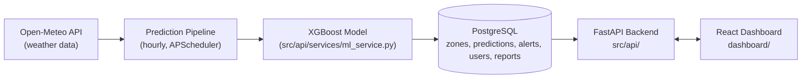

# NairobiFloodWatch

Real-time urban flash-flood prediction system for Nairobi County, Kenya —
a Strathmore University industry capstone project.

A trained XGBoost model classifies flood risk into four levels (**Low,
Moderate, High, Extreme**) across **8 Nairobi County zones**, using live
weather data. Predictions, alerts, and citizen reports are served through a
FastAPI backend to a React dashboard used by three kinds of users:

- **Citizens** — view current risk per zone and submit flood condition reports, no login required
- **Authorities (officers)** — monitor the live risk map, manage and acknowledge alerts
- **System administrators** — manage user accounts, alert thresholds, and review model performance

## Architecture



## Repository structure

```
Predictive-Flood-Modelling-System/
├── dashboard/        React + Vite frontend (citizen, officer, and admin views)
├── src/
│   ├── api/          FastAPI backend (routers, services, models, utils)
│   └── scripts/      init_db.py, run_pipeline.py
├── models/           Trained XGBoost model + scaler + feature columns (.joblib)
├── data/             Raw/processed data used for model training
├── notebooks/        Model training & evaluation notebook (FloodHub.ipynb)
├── tests/            Backend API smoke tests (pytest)
├── requirements.txt  Backend Python dependencies
└── .env.example      Backend environment variable template
```

## Quick start

Two independent apps make up the system — run them side by side during development.

### 1. Backend (FastAPI + PostgreSQL)

Install dependencies:

```
pip install -r requirements.txt
```

Set up PostgreSQL:

```
createdb nairobifloodwatch
```

or via `psql`:

```sql
CREATE DATABASE nairobifloodwatch;
```

Copy the environment file and edit it with your DB password and secret key:

```
cp .env.example .env
```

Generate a secret key (minimum 32 characters):

```
python -c "import secrets; print(secrets.token_hex(32))"
```

Initialise the database and seed zones/users/initial predictions:

```
python -m src.scripts.init_db
```

Start the API server:

```
uvicorn src.api.main:app --reload --port 8000
```

Access the API docs:

- Swagger UI: http://localhost:8000/docs
- ReDoc: http://localhost:8000/redoc

Run tests (requires the seeded database above):

```
pytest tests/ -v
```

Run the prediction pipeline manually:

```
python -m src.scripts.run_pipeline
```

To use your own trained model, drop these three files into `models/` (see
`MODEL_PATH`/`SCALER_PATH`/`FEATURE_COLS_PATH` in `.env` if you rename them),
then restart the server:

```
models/flood_model_final.joblib
models/scaler_final.joblib
models/feature_cols_final.joblib
```

### 2. Frontend (React dashboard)

```
cd dashboard
npm install
npm start
```

The dashboard runs at http://localhost:5173 with routes `/` (public map),
`/citizen`, `/login`, `/officer`, `/officer/alerts`, and `/admin`.

### Prediction refresh (issue #9)

The map, citizen risk cards, and officer risk table share one live `GET /dashboard`
subscription. Keep the backend running alongside Vite. To change the API origin or
refresh timing, copy `dashboard/.env.example` to `dashboard/.env.local` and restart
Vite (or rebuild for deployment).

| Variable | Default | Purpose |
|----------|---------|---------|
| `VITE_API_BASE_URL` | `http://localhost:8000` | Backend origin; allow the frontend origin via backend `FRONTEND_URL` |
| `VITE_PREDICTION_POLL_INTERVAL_MS` | `60000` | Delay between completed prediction requests |
| `VITE_PREDICTION_STALE_AFTER_MS` | `3900000` | Mark predictions older than 65 minutes as stale |

Predictions are fetched immediately on page load, then every minute after the
previous request settles. This checks saved results from the hourly backend
pipeline; it never triggers inference. Manual refresh, returning to the tab, and
regaining connectivity also check for updates. Requests time out after 15 seconds;
requests do not overlap, and unmounting cancels requests and timers.

Failed refreshes retain the last successful snapshot with a visible warning.
Each zone displays its actual prediction timestamp in Africa/Nairobi time. Zones
without predictions show **Unknown**, and empty results do not imply low risk.
The API does not supply rainfall totals, so those fields show **Unavailable**.

Only prediction data and the summary alert count are connected in this issue.
Authentication, alert actions, user management, and model/system panels still use
the existing demo implementation and require separate integration work. Citizen
report submission is connected as described below.

Run the polling/response regression tests and production build from `dashboard/`:

```text
npm test
npm run build
```

### Public citizen warnings and reports (issue #25)

At `/citizen`, residents can filter the live warning cards by zone and select
**Report conditions** on a card to preselect that zone in the reporting form.
Warnings with old prediction timestamps are labelled as saved warnings.

The form submits anonymously to `POST /citizen-report`, using zone IDs from the
dashboard API. Supported conditions are Street flooding, River overflow, Blocked
drainage, and Other; severities are Mild, Serious, and Dangerous. Descriptions are
optional, limited to 200 characters, trimmed, and stored as null when blank.
The frontend validates entries, and the backend enforces the same values and
length limits. Zone IDs must exist in the database; the form offers no unsupported
"Other" zone.

While submitting, the form blocks repeated submissions. Success appears only
after HTTP 201 confirms the saved report ID and timestamp. Failures preserve the
entered details and show a retry message or field errors. Requests time out after
15 seconds and are cancelled when navigating away. Submissions are never retried
automatically because a lost response can follow a successful save. Reports do
not directly change model predictions or displayed risk levels.

Reports persist in `citizen_reports` and are available through the existing
admin-only `GET /citizen-reports` endpoint. The admin dashboard's report list still
uses demo data pending authentication/admin API integration.

Run the frontend tests/build above and the isolated report API tests from the
project root (with the normal backend environment configured):

```text
python -m pytest tests/test_reports.py -v
```

These report tests use an in-memory SQLite database and do not write to the
configured PostgreSQL database or start the prediction scheduler.


## Notes

- If `models/flood_model_final.joblib` (and its scaler/feature-columns
  companions) are missing, the API still starts — `MLService` falls back
  to mock "Moderate" predictions and logs a warning.
- The hourly prediction pipeline uses county-level Open-Meteo weather data
  applied identically to all 8 zones; zone differentiation is baked into
  the model via terrain features used at training time.
- Model performance (test set 2024–2026): AUC-ROC 0.8732, weighted recall
  0.7880. Moderate/High recall are below target due to training data
  scarcity — expected to improve with TAHMO ground station integration.
