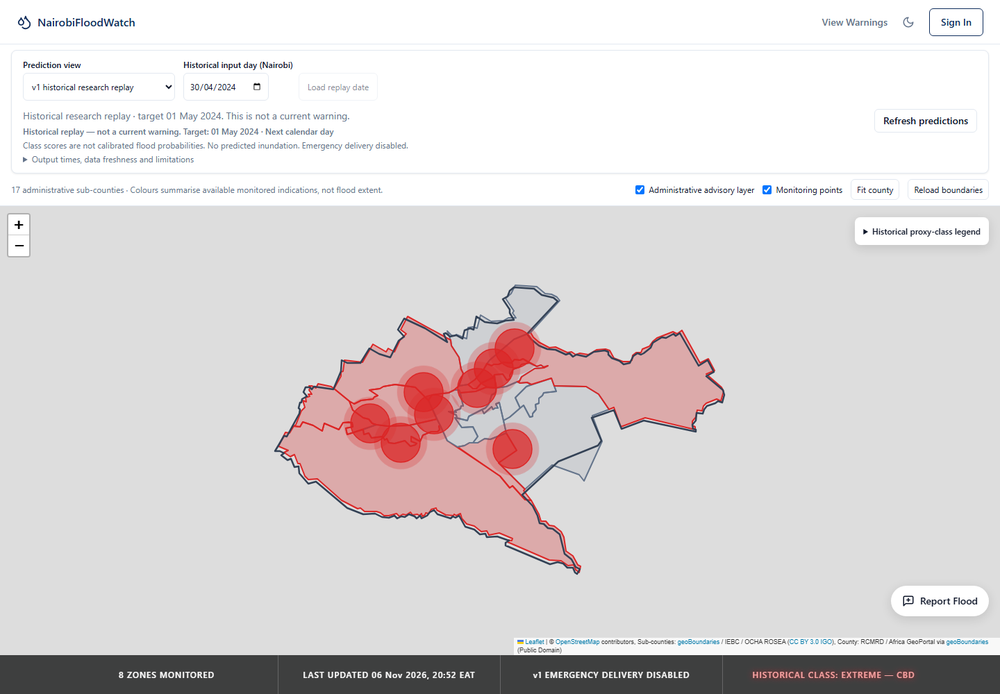
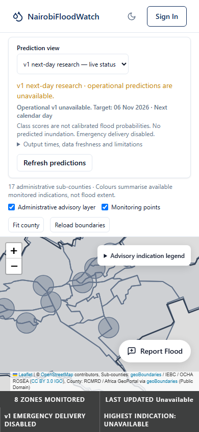

# v1 integration validation — 6 November 2026

Outcome: **Prompt1 research replay acceptance passed. Operational/live acceptance remains blocked.** Prompt2 was not started. The selected v1 model was not retrained, replaced by the experimental candidate, calibrated to observed floods or promoted for emergency delivery.

## Environment and input identity

- Application: Windows, Python3.12.1, XGBoost2.0.3, sklearn1.4.2, NumPy1.26.4, pandas2.2.1, FastAPI0.111.0, SQLAlchemy2.0.30.
- Native v1 subprocess: Python3.12.1, **XGBoost3.1.3**, NumPy1.26.4, SciPy1.17.1. Original producer versions remain in the experiment manifest. Application packages were not upgraded.
- Native database tests/local development check: PostgreSQL18.6, PostGIS3.6.2. Browser: installed headless Chrome; frontend runtime Node23.1.0/npm11.6.2/Vite5.4.21. No training hardware or production-performance claim is made.
- All supplied handoff SHA256SUMS entries matched. Tracked `src/modeling/v1/package_manifest.json` pins the exact model, schema/classes/manifest/evaluation and nine separately restored source files. Original legacy model/scaler/feature-file hashes were retained.
- Source data/model binaries, alternative joblib, full handoff and isolated environment remain ignored. Only small integrity/evaluation metadata, code, tests and labelled evidence are versioned.

## Reproduced feature and model parity

Command (from repository root, with approved ignored inputs installed):

```powershell
.venv/Scripts/python.exe -m src.scripts.verify_model_v1 --postgres-replay --output docs/integration/model_v1_parity.json --api-samples "$env:TEMP/floodhub-v1-verified-api.json"
```

Exit0. Full machine-readable results are in [model_v1_parity.json](model_v1_parity.json). The verifier uses no fitting, network calls or arbitrary pickle deserialization.

| Check | Actual observed result |
| --- | --- |
| Native artifact | `b185eced1e8887b0fdbcb539567ea4f7d485583848c81c81eacc2979d8c728bb`;20 exact ordered features,4classes,496rounds |
| Older application native compatibility probe | All5,848 classes agree, but maximum score error6.499645996083103e−6 fails supplied `rtol=atol=1e−6`; older runtime deliberately not used for v1 |
| Isolated native score comparison | All5,848 classes agree; max absolute score error **2.980194091506405e−8**; raw scores retained |
| Canonical reconstructed features versus frozen inputs | 5,848 rows/eight zones; max absolute error **8.526512829121202e−14** |
| Real raw hourly CBD2024-04-30 → all ten weather features |24 input-day records only; max difference **1.021405182655144e−14**; no target-day weather |
| Source/target leakage checks | Preceding CHIRPS windows exclude D; season uses D; changing target-day rows cannot change feature result |
| Identical inputs | Identical scores retained; no client/server noise or fake spatial differentiation |
| Scientific status | Proxy target only; no observed-flood validation, forecast issue-time availability or calibrated flood probabilities |

Recomputed held-out proxy metrics, target dates2024–2025:

| Metric | Reproduced value |
| --- | ---: |
| Accuracy |0.8117305061559508|
| Macro F1 |0.6481525953286972|
| Weighted F1 |0.816837238590005|
| High recall |0.6262975778546713|
| Extreme recall |0.3377777777777778|

These match the supplied frozen evaluation within tolerance. They do not measure actual flood detection. The standalone metric check produces an older-sklearn warning concerning float32 score sums during log-loss evaluation; model output sums are checked within1e−6 and no stored scores are normalized/clipped to hide a compatibility failure.

## Automated suites

Final full backend command:

```powershell
$env:RUN_POSTGIS_TESTS = '1'
$env:RUN_MODEL_V1_POSTGRES_TESTS = '1'
.venv/Scripts/python.exe -m pytest tests/ -k 'not reference_refit' -q
```

Observed exit0: **297 passed,1deselected,35warnings in42.16s;0skipped**. This is a functional regression run time, not an API latency measurement.

| Test file | Selected passing cases | Main evidence |
| --- | ---: | --- |
| `tests/test_api.py` |11| Existing smoke routes now use isolated SQLite and actual fixture JWT/login/role checks; no configured-user/report/alert mutations |
| `tests/test_boundaries.py` |23| Existing provenance/validation/failure cases plus6native PostGIS tests |
| `tests/test_model_audit.py` |3| Legacy artifact/report behavior |
| `tests/test_model_inputs.py` |22| Legacy numeric/weather/timezone/failure contracts |
| `tests/test_prediction_pipeline.py` |7| Legacy isolated atomicity/shared scope/alert cooldown |
| `tests/test_proxy_evaluation.py` |17| Existing offline daily replay/data quality; fitting diagnostic excluded |
| `tests/test_proxy_v1_api.py` |27| Real auth401/403, output/OpenAPI, historical/live separation, missing/stale/model failure, independently built zones, idempotency/conflicts, rollback/history, startup no side effects, actual historical runtime integration |
| `tests/test_proxy_v1_postgres.py` |5| Additive/repeatable migration and safe down, identical/conflicting concurrent workers, partial-insert rollback, nonempty-down refusal, real scheduler advisory lock/hour dedup |
| `tests/test_reports.py` |15| Existing isolated public submission/validation/rollback |
| `tests/test_v1_features.py` |30| Typed complete-day inputs, no guesses, trusted source anchors, missing observation metadata, all5,848 real feature rows and raw-hourly case |
| `tests/test_v1_runtime.py` |137| Exact schema/finite/bounds, native integrity/version/output shape, corrupt registry/worker failures, copy integrity, missing cached runtime and full frozen score parity |

The deliberately deselected `test_reference_refit_is_explicit_train_only_and_never_exports` fits a small diagnostic classifier. It was excluded so no classifier training would occur during integration. Source inspection, scaler fixture construction and predictions do not retrain the selected model.

Warnings left visible: legacy joblib XGBoost serialization and sklearn scaler-version mismatch, Starlette/AnyIO deprecation, and python-jose UTC deprecation. They are pre-existing legacy/dependency issues; the selected native v1 loader uses neither legacy joblib nor sklearn persistence.

Frontend commands, from `dashboard/`:

```powershell
npm.cmd test
npm.cmd run build
```

Observed **55passed,0failed/skipped**: original36 tests plus19 v1 normalization/mode/date/failure/score cases. Latest production build exited0:2,392modules,16.94s, JS789.35kB/gzip230.53kB, CSS35.12kB/gzip11.35kB. Existing Node23 module-loading and >500kB bundle warnings remain. Build success is not deployment or browser-performance proof.

## Real database/API workflow and preserved legacy behavior

The verifier first created a UUID-named disposable PostgreSQL schema with the actual public monitoring configuration, applied the migration, built/inferred/persisted April30→May1 with the real artifact, reran idempotently, checked history and live Unknown, then removed only that schema. It retained1run/8zone results inside that isolated check and no external alert deliveries. Native tests independently exercise concurrent workers and transaction failure with fixtures.

After the isolated checks passed, the configured target was privately checked to be **loopback + development**, then the additive migration was applied locally:

```powershell
.venv/Scripts/python.exe -m src.scripts.migrate_model_v1 --schema public
```

An explicit research replay with input2024-04-30/issue2024-05-01T00:00:00+03:00/key `research-v1-2024-04-30-all` was recorded through `ProxyV1Service`. It returned SUCCESS,8zones and `idempotent_replay=true` on repeat. Local companion counts: **1run,8zone results,8terrain versions**. Legacy counts immediately before/after were unchanged:8zones,88legacy predictions,2users,0citizen reports,0alerts. No old rows were replaced, no login metadata was changed, no v1 record entered legacy prediction/alert tables.

Read-only FastAPI TestClient checks against those real local records returned200 for model, v1 live dashboard, dated replay, CBD/May1 history, legacy dashboard and boundaries. The actual public GeoJSON contained18features, old/new dashboards each8zones, history returned1CBD target record, and live known classes remained0. Their typed JSON was passed directly through the frontend's `normalizeProxyDashboard`/`normalizeProxyModel`: all contracts passed.

The real April30 hindcast assigns **Extreme to all eight zones**, while keeping each zone's own feature hash/record/scores. That is an honest model result, not copied scores or evidence that all eight places actually flooded. The supplied UNOSAT reference is a separate historical case study with only four partially observed zones; no inundation layer or flood-event validation was implemented here.

## Browser evidence

Reproducible harness, after build, from repository root:

```powershell
node dashboard/scripts/verifyProxyUI.mjs
# Optional captured actual model/live/replay/legacy/boundary API JSON:
node dashboard/scripts/verifyProxyUI.mjs PATH_TO_CAPTURED_API_JSON
```

Default harness data are clearly synthetic API fixtures. The **recorded screenshots and [browser-verification.json](evidence/browser-verification.json)** use captured actual local native-model/PostgreSQL/FastAPI read responses, rendered by Chrome at1440×1000 and390×844. Requests were intercepted; external tile/network traffic was stubbed and every write blocked. Thus this is browser rendering of real captured responses, not a browser directly hitting a production service. An HTTP503 was deliberately injected to test same-replay retention; it was not an observed provider outage.

Both sizes passed:17sub-county paths,8monitoring markers, no horizontal overflow, selectable legacy, live allUnknown/gray with no emergency delivery, explicit historical target01May2024, no current-warning interpretation, same-date replay retention on failure, and clearing replay when returning to live. Timestamps/freshness/limitations can be expanded in an accessible details panel; persistent target/research caveats remain visible. Mobile content can scroll vertically; no all-content-in-one-viewport claim is made.





## Defects caught and retested

| Finding | Correction / evidence |
| --- | --- |
| Older native library loads but scores differ beyond tolerance | Isolated matching XGBoost3.1.3, no tree/base-score editing; all frozen outputs verified |
| Corrupt registry/non-object worker response escaped loader error handling; cached runtime could hide missing executable | Controlled artifact errors/unavailable metadata plus regression tests |
| Installer trusted copied bytes without rechecking | Verify temporary copied bytes before atomic promotion; injected bad-copy test passes |
| Mutable source manifest could reauthor source checksums | Compare files/recipe against tracked trust anchor; forged-checksum test rejects |
| Missing source day could inherit requested date as an observation time | Unknown timestamps stay null unless an actual valid source row exists; live-expired/missing-zone tests pass |
| Small-screen status/button columns left too little readable map space | Full-width mobile status and collapsible detailed metadata; build/browser retest passed |
| New date guard used a date-valued numeric schema bound incompatible with pinned OpenAPI generator | Initial rerun had1failed/296passed. Replaced with explicit request/query validation; final full rerun297passed. No dependency upgrade required. |
| Browser assertion expected newly collapsed metadata in visible text | Harness explicitly opens details before checking status; retest passed |
| Reusing the scientific identity with a different explicit key could create an untracked alias | Explicit409 for a second alias; original-key/no-key replays stay idempotent; regression and native concurrency tests pass |

## Acceptance gate and limitations

| Prompt1 criterion | Result |
| --- | --- |
| Exact selected v1/native schema/classes/integrity/runtime | PASS; full frozen tolerance verified |
| Real zone/date feature parity and no target leakage | PASS for hash-verified historical source; raw-hourly case independently checked |
| Zone-associated construction/record independence; identical inputs unchanged | PASS; coarse/overlapping source limitations exposed |
| Missing/late/stale source or missing terrain fails safely | PASS for implemented validation/status pathways; no production adapter claimed |
| Typed API, authorization, idempotency, rollback, history, legacy compatibility | PASS in isolated/native tests and actual local read workflow |
| No startup side effects/multiworker duplicate v1 runs; honest frontend | PASS within tested scope; no v1 hourly schedule |
| Tests, build, manual replay, docs and evidence | PASS; fitting diagnostic explicitly excluded |
| Operational real-time forecasts/emergency delivery | **BLOCKED / NOT APPROVED** |
| Observed-flood probabilities/inundation validation | **NOT IMPLEMENTED** |

Exact remaining blockers: original CHIRPS release timestamps and publication lag; CHIRPS versus Nairobi-local accumulation alignment; retrospective ERA5 availability at issue time; incomplete terrain extraction provenance and static2023/2021 approximations; absent approved live source adapter; no independently verified flood/non-flood calibration or local spatial validation. Current forecasts/partial-day data were not substituted. No server uptime, emergency reliability, deployment readiness or flood-depth/extent result is claimed.

Stakeholder approval is required before a later live-source/retraining policy, emergency alert/delivery threshold policy, any Extreme→Very High mapping, operational promotion or the broader roadmap. Existing frontend authentication/user/report-management demo workflows remain outside this integration; new run endpoints enforce real backend admin authorization. All work stops at the research replay gate.
